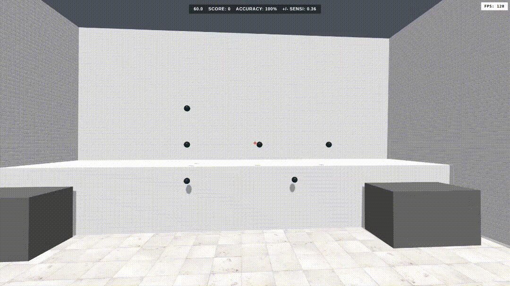

# 3d AIM Trainer

A web based aim trainer which is written in html, css, and three.js. It is mainly designed for competitive games.

## Quick start

1. Open the link.
2. Pick Sixshot or Gridshot.
3. Click on the game to lock the mouse, and the game timer starts just after you shoot.

## Features

- Menu to pick gamemode.
- Timer, score, and accuracy points tracker
- GRIDSHOT: 3 big targets on a 4x3 grid. SIXSHOT: 6 small targets on a 6x3 grid.
- Shooting mechanism with smooth aiming system.
- FPS counter

## Run locally

VS Code ---> right-click `index.html` ----> Open with Live Server. Opening the file directly won't work (ES modules and textures need `http://`).

Desktop + mouse only, it needs pointer lock.

## How it works
Each of the mode builds its own three.js shooting range/arena. Shooting raycasts from the screen center (where the crosshair is), killed targets respawn on a free slt. The timer uses "performance.now()" in a 100ms intervals, so we could see the tenths. The game shows the result in alert() for now, and will redirect to the menu.
